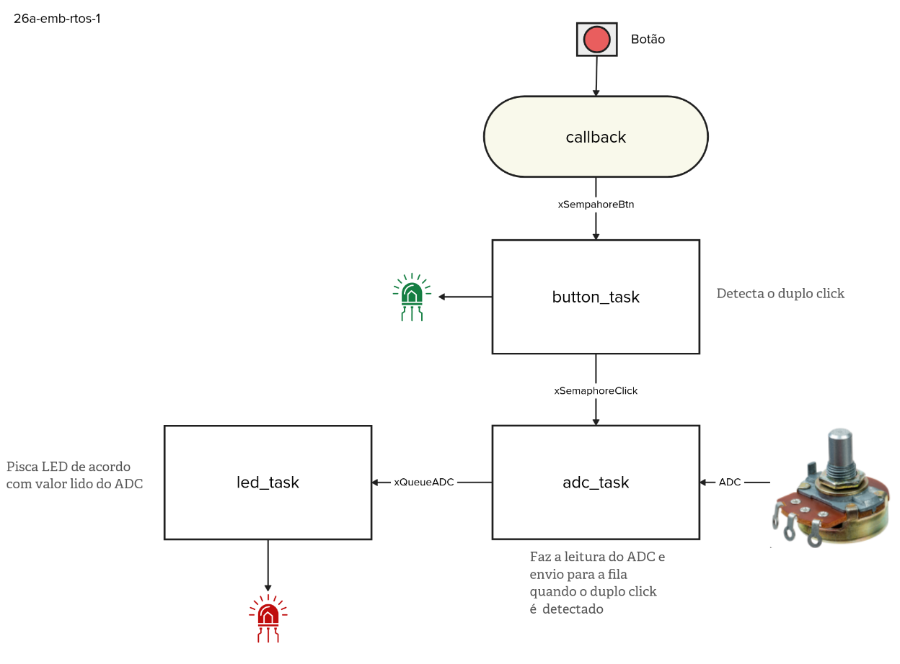

# AV - RTOS - 1

Neste exercício, vocês devem utilizar o RTOS para controlar um LED cuja frequência de piscada é definida por um potenciômetro lido via ADC.

A frequência do LED só deve ser atualizada quando um **duplo clique válido** for detectado no botão.

Vamos ter dois LEDs: um para idincar o status do click e outro que ficará piscando de acordo com o valor do ADC.

## Funcionamento

- O botão deve detectar um **duplo clique**:
  - Dois cliques em até **1 segundo** → duplo clique válido;
  - Se o segundo clique não acontecer em até 1 segundo, o evento deve ser descartado.

- Quando um duplo clique válido for detectado:
  - Ao detectar o primeiro click acender o LED click
  - Ao detectar o duplo click, piscar o LED click
  - Apagar o LED click após timeout ou confirmacão do duplo click
  - O valor do potenciômetro deve ser lido via ADC;
  - O LED piscante deve piscar em uma frequência proporcional ao valor do ADC;

- LED piscante:
  - Deve comecar sem piscar
  - Maior valor de ADC → LED pisca mais lento;
  - Menor valor de ADC → LED pisca mais rápido.

**MARCO: Da para dificultar aqui, só pedir para a frequência ser atualizada na hora que acontece o duplo click, queremos essa complicacao?**

## Estrutura do firmware

O firmware deve seguir a estrutura abaixo (verificada pelo `firmware_check`).

| Elemento RTOS      | Papel |
|--------------------|-------|
| `callback`         | ISR do botão. Deve apenas liberar `xSemaphoreBtn`. |
| `button_task`      | Detecta o duplo clique usando timeout de 1 segundo. |
| `adc_task`         | Lê o valor do potenciômetro via ADC. |
| `blink_task`       | Controla a piscada do LED usando o valor do ADC. |
| `xSemaphoreBtn`    | ISR → `button_task` |
| `xSemaphoreClick`  | `button_task` → `adc_task` |
| `xQueueAdcValue`   | `adc_task` → `blink_task` |

## Requisitos

- O botão deve usar interrupção.
- A validação do duplo clique deve ser feita na `button_task`:
  - Liberando o semáforo `xSemaphoreClick`
  - Sinalizar no led click
- O ADC deve ser lido na `adc_task` sempre que um click for detectado:
  - O valor então enviado para `xQueueADC`
- O LED deve piscar por um tempo (você define) e na frequência proporcional ao valor do `ADC`
- Não é permitido usar:
  - `sleep_ms()`
  - `sleep_us()`
  - `get_absolute_time()`
  - `to_ms_since_boot()`
  - `to_us_since_boot`
  - variáveis globais (exceto recursos do RTOS)
- `printf` pode afetar a simulação. Comente antes dos testes.

## Testes

O código deve passar em:

- Teste de funcionalidade na placa
- `cppcheck`
- `embedded_check`
- `firmware_check`
