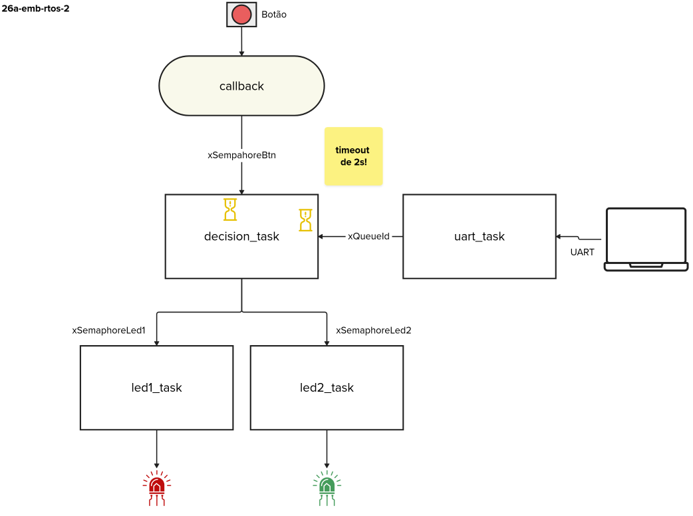

# AV - RTOS - 2

> [!CAUTION]
> Só chame para validação se você já testou antes (funcional e testes github)

Regras:

- Você pode consultar qualquer material SEU, e que foi fornecido ao longo do curso.
- Duração de 2h.
- **Não pode usar qualquer tipo de LLM** (chatgpt, copilot chat, ..).
- Deve manter o SMOWL ABERTO o tempo todo!

Devem criar um sistema embarcado que possibilite controlar o estado de dois LEDs. O controle é feito por um único botão. Para indicar qual LED terá seu estado alterado (por exemplo, de apagado para aceso), deve-se antes enviar um ID pela porta UART (`1` para o LED 1 e `2` para o LED 2).

Se o botão for apertado e não houver nenhum dado na UART, nada acontece. Se o dado for enviado pela UART e nenhum botão for apertado em até 2s, o sistema descarta o valor e invalida o envio, ou seja, não aceita mais aquele valor.

## Funcionamento

Normal:

* Os LEDs começam apagados.
* É feito o envio de um ID pela UART: `1` ou `2`.

  * O ID identifica o LED a ser controlado.
  * O valor do ID é enviado para a fila `xQueueId`.
* O botão é apertado, confirmando a mudança.
* É liberado o semáforo que representa o LED (`xSemaphoreLedID`).
* O LED identificado pelo `ID` muda de estado.

Timeout:

* É feito o envio de um ID pela UART.
* Passam-se **2s**.
* O botão é **apertado**.
* Nada deve acontecer (`timeout`).

Sequência errada:

* O botão é apertado.
* É feito o envio de um ID pela UART.
* Nada deve acontecer (`sequência errada`).

O código deve funcionar infinitamente. Caso ocorra um timeout ou uma sequência errada, o sistema deve voltar para o estado normal de operação, aceitando uma nova sequência.

## Estrutura do firmware

O firmware deve seguir a estrutura abaixo, que será verificada pelo `firmware_check`.



| Elemento RTOS    | Papel                                              |
| ---------------- | -------------------------------------------------- |
| `callback`       | ISR do botão. Deve apenas liberar `xSemaphoreBtn`. |
| `decision_task`  | Decide qual LED irá mudar de estado.               |
| `uart_task`      | Recebe o ID pela UART.                             |
| `led1_task`      | Controla o LED 1.                                  |
| `led2_task`      | Controla o LED 2.                                  |
| `xSemaphoreBtn`  | ISR → `decision_task`.                             |
| `xQueueId`       | ID do LED a ser alterado.                          |
| `xSemaphoreLed1` | Controla o LED 1.                                  |
| `xSemaphoreLed2` | Controla o LED 2.                                  |


### Uart task

Considerar utilizar a UART task a seguir, que recebe `0` ou `1` da UART, converte para inteiro e imprime novamente.

``` c
void uart_task(void* p) {

    while(1) {
        char r = uart_getc(uart0);
        int id = r - 48;
        if ((id == 1) || (id == 2)) {
            printf("%d \n", id);
        }
    }
}
```


## Requisitos

* O botão deve usar interrupção.
* Não é permitido usar nenhum timer:
    * `sleep_ms()`
    * `sleep_us()`
    * `get_absolute_time()`
    * `to_ms_since_boot()`
    * `to_us_since_boot()`
  * variáveis globais, exceto recursos do RTOS

## Testes

O código deve passar em:

* Teste de funcionalidade na placa
* `cppcheck`
* `embedded_check`
* `firmware_check`
